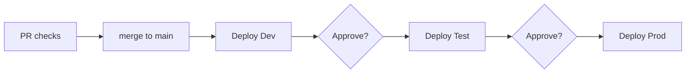

# Environments and deployment

Target: **Azure Container Apps** via Aspire ([ADR-0005](../decisions/0005-deploy-to-azure-container-apps.md)).
The eShop AppHost already declares `AddAzureContainerAppEnvironment("aca")`.

## Environments

| Env | Purpose | Hosting | Deployed by | Data | Status |
|-----|---------|---------|-------------|------|--------|
| Local | Development | `aspire run`, containers in Docker/Podman | Developer | Seed data in local containers | Exists |
| CI | PR validation and e2e | GitHub Actions (ubuntu-latest), `ESHOP_USE_HTTP_ENDPOINTS=1` | Workflows | Seed data | Exists |
| Dev | Integrated testing on every merge to `main` | ACA, resource group `rg-eshop-dev-eastus2` | GitHub Actions + `aspire deploy` | Seed / synthetic data | Proposed |
| Test/UAT | Release validation, demos | ACA, `rg-eshop-test-eastus2` | Manual approval gate | Synthetic data | Proposed |
| Prod | Customers | ACA, `rg-eshop-prod-eastus2` | Manual approval gate | Real data | Proposed |

## Deployment flow (proposed)

- `aspire deploy --non-interactive` with `Azure__SubscriptionId`, `Azure__Location`, and `Azure__ResourceGroup` set per environment.
- GitHub Actions authenticates to Azure with OIDC federated credentials. Secrets are never long-lived.
- In deployed environments, use managed Azure services instead of containers:
  - Azure Database for PostgreSQL (with pgvector)
  - Azure Cache for Redis
  - RabbitMQ (or Azure Service Bus, see the [tech radar](../standards/tech-radar.md))

## Configuration differences

| Setting | Local/CI | Deployed |
|---------|----------|----------|
| `PaymentOptions:PaymentSucceeded` (PAY-001) | `true` | Stripe (test mode in Dev/Test, live in Prod) |
| Health endpoints `/health`, `/alive` | Mapped | Not mapped (Development only), so changing this needs an ADR |
| Interactive auth | PKCE optional locally | PKCE required |
| AI (`UseFoundry`) | Optional | Off in Dev; on in Test and Prod |
| Rules database `rulesdb` (BusinessRules.API) | Database on the shared Postgres container | Database on Azure Database for PostgreSQL |
| Service-client secrets `businessrules-reader-secret` (Ordering.API → BusinessRules.API) and `businessrules-api-secret` (BusinessRules.API → Ordering.API) | Aspire secret parameters with generated, persisted values | One value per environment, managed in Azure Key Vault (Proposed) |
| `eshopadmin-url` (eShop AppHost; becomes Identity.API's `EShopAdminClient`) | `https://localhost:7250` | eShopAdmin's public URL |
| `identity-url`, `businessrules-url`, `catalog-url` (eShopAdmin AppHost, `AddExternalService`) | `https://localhost:5243`, `http://localhost:5230`, `http://localhost:5222` (eShop launch-profile ports). CI with `ESHOP_USE_HTTP_ENDPOINTS=1` overrides `identity-url` to `http://localhost:5223` | Internal FQDNs inside eShop's ACA environment, because BusinessRules.API ingress is internal (Proposed) |

The service-client secrets are declared in `AddBusinessRules` (`eShop/src/eShop.AppHost/Extensions.cs`)
and passed to Identity.API, which issues the client-credentials tokens
([ADR-0008](../decisions/0008-runtime-business-rules-service-and-in-house-experimentation.md), Proposed).

The URL parameters follow [ADR-0009](../decisions/0009-per-repo-apphost-with-external-services.md)
(Proposed): each repo has its own AppHost, and a satellite repo such as eShopAdmin declares eShop's
services as external services. Phase 3 does not deploy eShopAdmin. When it is deployed, it joins eShop's
ACA environment.

## Open questions

- Subscription layout: one subscription per environment, or a shared one?
- Custom domains, TLS, and WAF/Front Door in front of WebApp and Identity.API.
