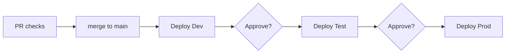

# Environments and deployment

Target: **Azure Container Apps** via Aspire ([ADR-0005](../decisions/0005-deploy-to-azure-container-apps.md)).
The eShop AppHost already declares `AddAzureContainerAppEnvironment("aca")`.

## Environments

| Env | Purpose | Hosting | Deployed by | Data | Status |
|-----|---------|---------|-------------|------|--------|
| Local | Development | `aspire run`, containers in Docker/Podman | Developer | Seed data in local containers | Exists |
| CI | PR validation and e2e | GitHub Actions (ubuntu-latest), `ESHOP_USE_HTTP_ENDPOINTS=1` | Workflows | Seed data | Exists |
| Dev | Integrated testing on every merge to `main` | ACA, resource group `rg-eshop-dev-eastus2` | GitHub Actions + `aspire deploy` | Seed / synthetic data | Proposed |
| Test/UAT | Release validation, demos | ACA, `rg-eshop-test-eastus2` | Manual approval gate | Synthetic data | Proposed |
| Prod | Customers | ACA, `rg-eshop-prod-eastus2` | Manual approval gate | Real data | Proposed |

## Deployment flow (proposed)

- `aspire deploy --non-interactive` with `Azure__SubscriptionId`, `Azure__Location`, and `Azure__ResourceGroup` set per environment.
- GitHub Actions authenticates to Azure with OIDC federated credentials. Secrets are never long-lived.
- In deployed environments, use managed Azure services instead of containers:
  - Azure Database for PostgreSQL (with pgvector)
  - Azure Cache for Redis
  - RabbitMQ (or Azure Service Bus, see the [tech radar](../standards/tech-radar.md))

## Configuration differences

| Setting | Local/CI | Deployed |
|---------|----------|----------|
| `PaymentOptions:PaymentSucceeded` (PAY-001) | `true` | Stripe (test mode in Dev/Test, live in Prod) |
| Health endpoints `/health`, `/alive` | Mapped | Not mapped (Development only), so changing this needs an ADR |
| Interactive auth | PKCE optional locally | PKCE required |
| AI (`UseFoundry`) | Optional | Off in Dev; on in Test and Prod |

## Open questions

- Subscription layout: one subscription per environment, or a shared one?
- Will each repo have its own AppHost, or will a shared AppHost deploy all repos?
- Custom domains, TLS, and WAF/Front Door in front of WebApp and Identity.API.
