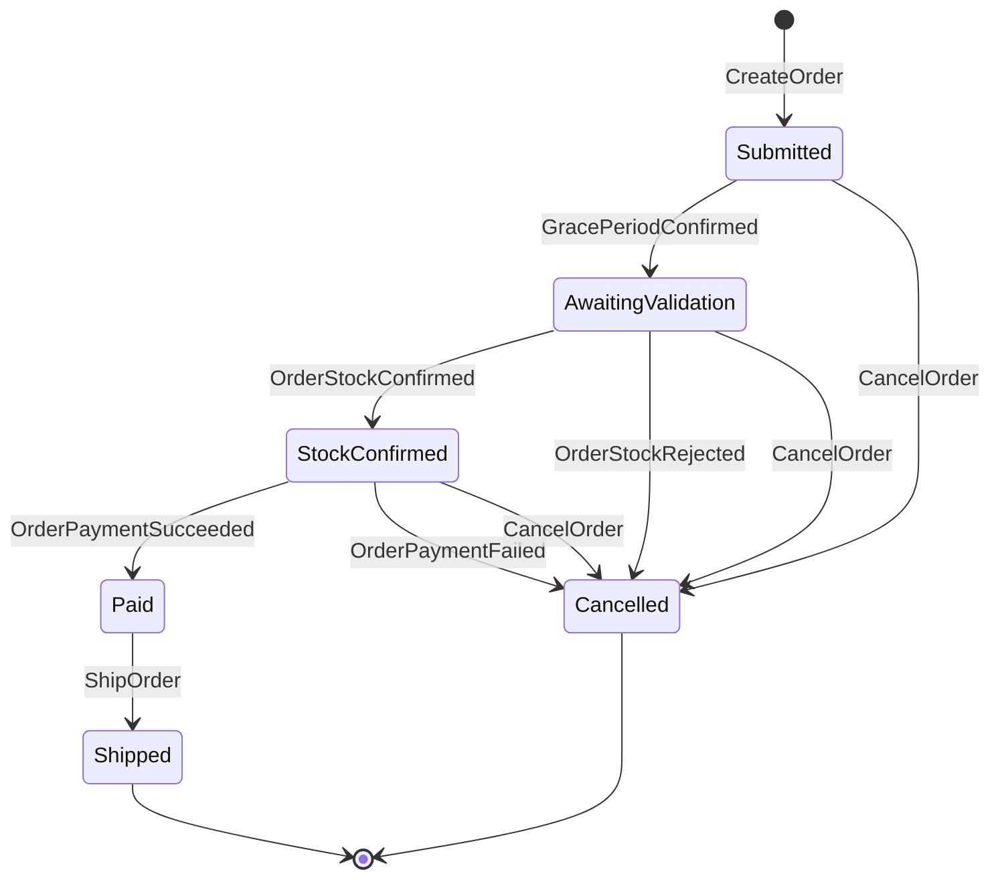

# Integration events

Transport: RabbitMQ (`eventbus`). Publishing uses the outbox (`IntegrationEventLogEF`).
Consumers are verified from `AddSubscription<...>()` registrations.

| Event | Publisher | Consumers |
|-------|-----------|-----------|
| `OrderStartedIntegrationEvent` | Ordering.API | Basket.API (clears basket) |
| `GracePeriodConfirmedIntegrationEvent` | OrderProcessor | Ordering.API |
| `OrderStatusChangedToSubmittedIntegrationEvent` | Ordering.API | WebApp |
| `OrderStatusChangedToAwaitingValidationIntegrationEvent` | Ordering.API | Catalog.API (stock check), WebApp |
| `OrderStockConfirmedIntegrationEvent` | Catalog.API | Ordering.API |
| `OrderStockRejectedIntegrationEvent` | Catalog.API | Ordering.API |
| `OrderStatusChangedToStockConfirmedIntegrationEvent` | Ordering.API | PaymentProcessor, WebApp |
| `OrderPaymentSucceededIntegrationEvent` | PaymentProcessor | Ordering.API |
| `OrderPaymentFailedIntegrationEvent` | PaymentProcessor | Ordering.API |
| `OrderStatusChangedToPaidIntegrationEvent` | Ordering.API | Catalog.API (decrement stock), Webhooks.API, WebApp |
| `OrderStatusChangedToShippedIntegrationEvent` | Ordering.API | Webhooks.API, WebApp |
| `OrderStatusChangedToCancelledIntegrationEvent` | Ordering.API | WebApp |
| `ProductPriceChangedIntegrationEvent` | Catalog.API | Webhooks.API |

## Order lifecycle (Ordering.Domain `Order`)

Rules enforced by the aggregate: cannot cancel once `Paid` or `Shipped`; can only ship from `Paid`.

When adding or changing an event, update this file in the same spec/PR.

## Proposed events

From the Approved [runtime rules spec](../specs/cross-repo/2026-11-03-runtime-business-rules-and-experiments-design.md). Status: **Proposed**; move into the table above when implemented.

| Event | Publisher | Consumers |
|-------|-----------|-----------|
| `BusinessRulesSnapshotPublishedIntegrationEvent` | BusinessRules.API (planned) | Ordering.API, WebApp |
| `OrderPricedIntegrationEvent` | Ordering.API | BusinessRules.API (planned) |

Proposed changes to existing events: BusinessRules.API also consumes `OrderStatusChangedToPaidIntegrationEvent`,
`OrderStatusChangedToShippedIntegrationEvent`, and `OrderStatusChangedToCancelledIntegrationEvent`;
`OrderStatusChangedToPaidIntegrationEvent.OrderStockItems` excludes unfulfillable lines (partial fulfilment).
