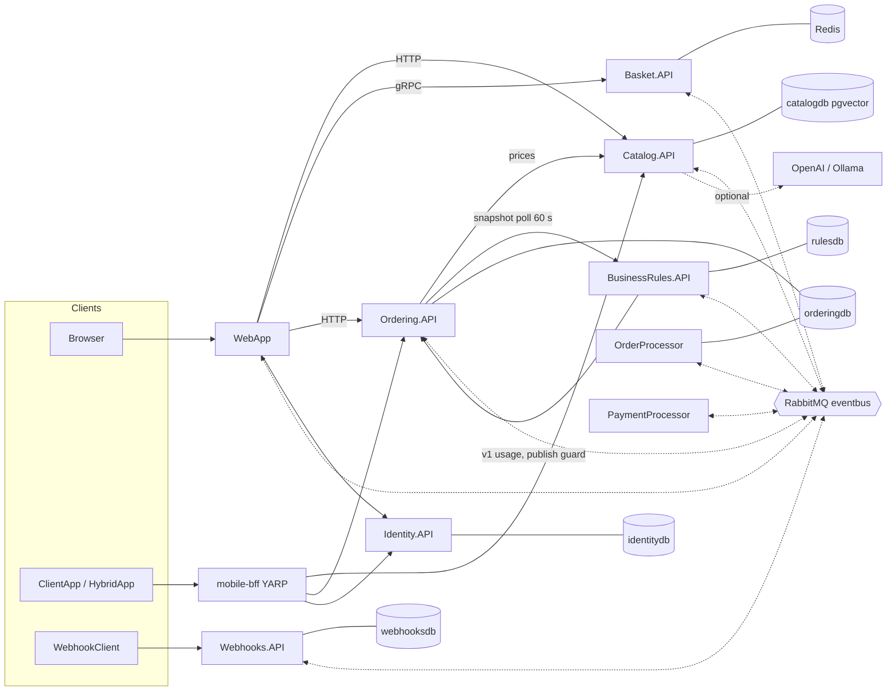

# System context

- All resources are orchestrated by `eShop.AppHost` (Aspire). One Postgres server, one DB per service.
- Solid arrows = synchronous calls; dotted = integration events
  (see [integration-events.md](integration-events.md)).
- BusinessRules.API (T3) is wired in `AddBusinessRules` (`eShop/src/eShop.AppHost/Extensions.cs`).
  Ordering.API polls it in the background and never `WaitFor`s it, so checkout works while it is down
  ([ADR-0008](../decisions/0008-runtime-business-rules-service-and-in-house-experimentation.md), Proposed).
  mobile-bff has no BusinessRules.API route.
- Planned additions (offering web apps, business-rules admin app): see
  [repos/registry.md](../repos/registry.md). Update this diagram when they land.
