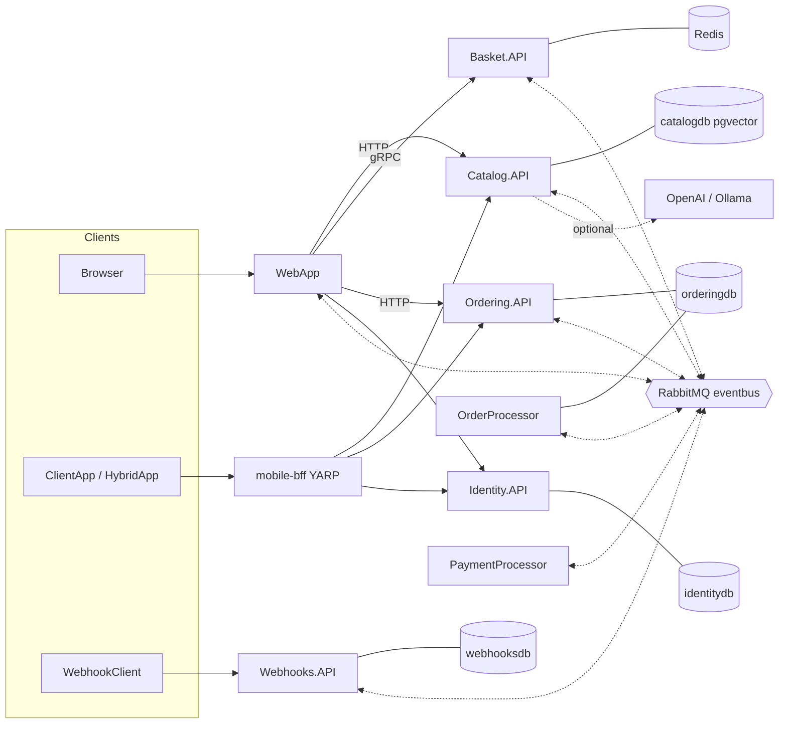

# System context

- All resources are orchestrated by `eShop.AppHost` (Aspire). One Postgres server, one DB per service.
- Solid arrows = synchronous calls; dotted = integration events
  (see [integration-events.md](integration-events.md)).
- Planned additions (offering web apps, business-rules admin app): see
  [repos/registry.md](../repos/registry.md). Update this diagram when they land.
