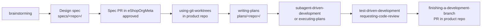

# Spec-driven development (Superpowers)

Every non-trivial change starts with a spec and a plan. We use
[Superpowers](https://github.com/obra/superpowers) (vendored, see
[.github/skills/VENDORED.md](../.github/skills/VENDORED.md)). Decision:
[ADR-0002](../decisions/0002-adopt-superpowers.md), [ADR-0003](../decisions/0003-specs-and-plans-in-meta-repo.md).

## Flow

| Step | Skill | Output | Where |
|------|-------|--------|-------|
| 1 | `brainstorming` | Design spec | `eShopOrgMeta/specs/<repo>/YYYY-MM-DD-<topic>-design.md` |
| 2 | — | Spec PR reviewed & merged | eShopOrgMeta |
| 3 | `using-git-worktrees` | Feature branch/worktree | Product repo |
| 4 | `writing-plans` | Implementation plan | `eShopOrgMeta/plans/<repo>/YYYY-MM-DD-<topic>.md` |
| 5 | `subagent-driven-development` / `executing-plans` | Code + tests | Product repo |
| 6 | `requesting-code-review`, `verification-before-completion` | Reviewed, verified change | Product repo |
| 7 | `finishing-a-development-branch` | PR linking spec + plan | Product repo |

## Sizing

- **Small change** (single repo, no API/event/schema change): short design in the spec file; plan optional.
- **Project** (new endpoint, integration event, schema migration, new service, cross-repo):
  full design using [templates/design-spec.md](../templates/design-spec.md), plan required, ADR if
  it sets precedent.
- **Bug fix:** start with `systematic-debugging`; a spec is only needed if the fix changes behavior
  or contracts.

## Rules

- `<repo>` = name from [repos/registry.md](../repos/registry.md); use `cross-repo` for multi-repo work.
- Product-repo PRs must link the spec and plan in eShopOrgMeta.
- Spec status lifecycle: `Draft` → `Approved` → `Implemented` (or `Superseded`). Update the spec
  front matter when the product PR merges.
